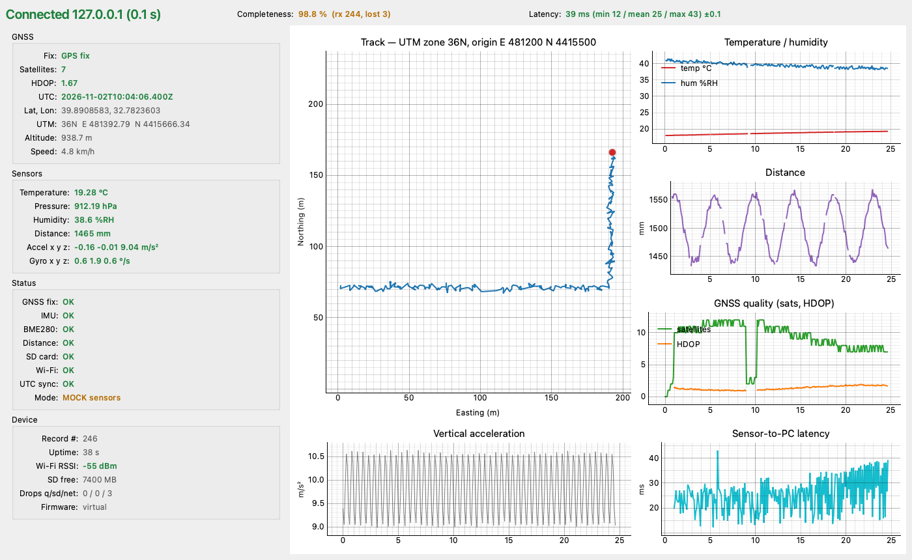
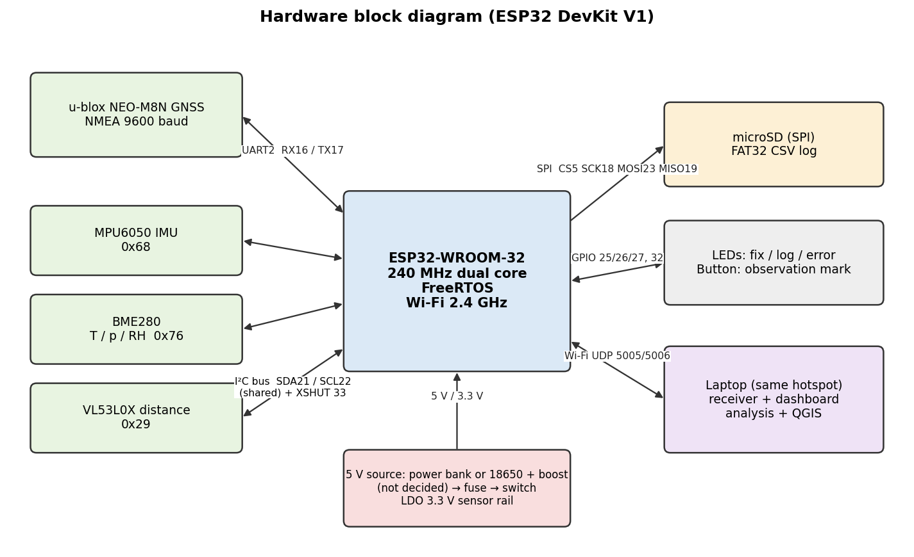
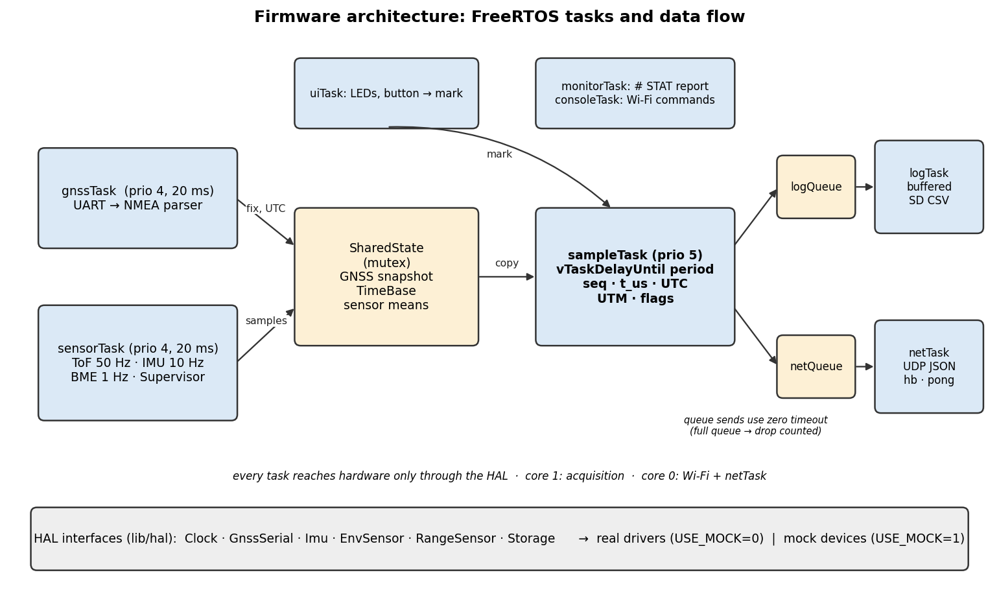
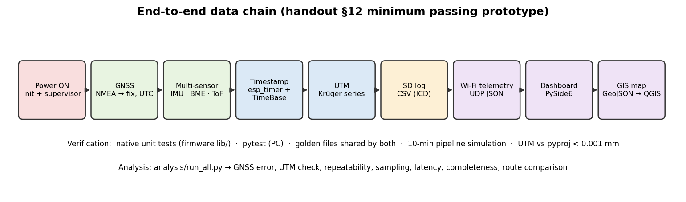

# ENG401 — Taşınabilir Akıllı Ölçme ve Çevresel Haritalama Sistemi

Elde taşınan bir ölçme cihazı: **ESP32 + GNSS (u-blox NEO-M8N) + IMU (MPU6050) + BME280 + VL53L0X + microSD**.
Cihaz konum ve sensör verisini zaman damgasıyla kaydeder, UTM'e çevirir, SD karta yazar, Wi-Fi üzerinden
bilgisayardaki canlı panele gönderir. Sonuçlar QGIS'te haritalanır.

```
Güç AÇ → GNSS → çoklu sensör okuma → zaman damgası → UTM → SD kayıt → Wi-Fi telemetri → PC paneli → GIS haritası
```



---

## 👋 Nereden başlamalıyım?

| Ekip | Ne yapacaksın? | Başlangıç dokümanı |
|------|----------------|--------------------|
| **Bilgisayar Müh. (CE) – donanım** | Lehim, kablolama, yazılımı karta yükleme, test sonuçlarını geri gönderme | [`docs/hardware-team/`](docs/hardware-team/) (sırayla 01 → 04) |
| **Geomatik Müh. (GE)** | Rota/referans noktaları, GNSS doğruluk analizi, bağımsız UTM kontrolü, QGIS haritaları | [`docs/geomatics-team/ANALIZ_KILAVUZU.md`](docs/geomatics-team/ANALIZ_KILAVUZU.md) |
| **Herkes** | Sistemin nasıl çalıştığını anlamak / sözlü sınava hazırlık | [`docs/report/D1_requirements_architecture.md`](docs/report/D1_requirements_architecture.md), [`docs/SOZLU_SINAV_NOTLARI.md`](docs/SOZLU_SINAV_NOTLARI.md) |

### Donanım ekibi için kısa yol
1. [`01_YAZILIM_YUKLEME.md`](docs/hardware-team/01_YAZILIM_YUKLEME.md): `.bin` dosyasını ESP32'ye yükleme
2. [`02_TESHIS_TEST_PROSEDURU.md`](docs/hardware-team/02_TESHIS_TEST_PROSEDURU.md): teşhis yazılımıyla sensörleri tek tek test etme
3. [`03_UYGULAMA_YAZILIMI.md`](docs/hardware-team/03_UYGULAMA_YAZILIMI.md): asıl ölçme yazılımı ve Wi-Fi ayarı
4. [`04_SAHA_ONCESI_TESTLER.md`](docs/hardware-team/04_SAHA_ONCESI_TESTLER.md): sahaya çıkmadan önceki kontroller
5. Pin bağlantıları: [`docs/PINOUT.md`](docs/PINOUT.md)

Hazır yazılım dosyaları (`.bin`) **[Releases](../../releases)** sayfasındadır:

| Sürüm | Ne için? |
|-------|----------|
| `v0.1.1-diag` | Teşhis yazılımı: I²C taraması, ham NMEA, sensör testleri |
| `v0.2-app` | Gerçek sensörlerle ölçme yazılımı |
| `v0.2-app-mock` | Sensörsüz çıplak ESP32: sahte veri üretir, Wi-Fi/panel testi için |

`.bin` dosyası **0x0** adresine yüklenir (detaylar 01 numaralı kılavuzda).

---

## Sistem mimarisi





- **Firmware (ESP32, FreeRTOS):** her sensör ayrı görevde çalışır. Örnekleme görevi sabit periyotta kayıt
  üretir (sıra no + µs zaman damgası + UTM). Kayıtlar kuyruklarla SD'ye ve UDP telemetriye gider.
- **Zaman:** GNSS UTC ile ESP32'nin monoton saati eşlenir (PPS gerekmez).
- **UTM:** cihazda kendi Transverse Mercator (Krüger, WGS84) kodumuzla hesaplanır, PC'de `pyproj` ile bağımsız doğrulanır.
- **PC:** UDP alıcı → CSV + canlı panel (PySide6/pyqtgraph). Analiz betikleri → rapor, grafikler, GeoJSON → QGIS.
- Veri formatları: [`docs/ICD.md`](docs/ICD.md)

## Klasör yapısı

```
firmware/      PlatformIO projesi (ESP32 yazılımı + birim testleri)
pc/surveypc/   UDP alıcı, canlı panel, sanal ESP32, log tekrar oynatma
analysis/      Gerekli tüm testler + GIS dışa aktarma (run_all.py, verify_utm.py)
data/sample/   10 dakikalık örnek (simülasyon) ölçüm + gerçek referans
docs/          Kılavuzlar, ICD, pin tablosu, D1 raporu
shared/golden/ Diller arası test verileri (UTM vektörleri, NMEA, kayıt örnekleri)
tools/         Release ve test verisi üretme betikleri
reference/     Ders föyü ve malzeme listesi
```

## Kurulum (yazılım geliştirmek / analiz çalıştırmak isteyenler için)

Gerekenler: Python 3.10+, git.

```bash
git clone <bu-repo-adresi>
cd eng401
python3 -m venv .venv
.venv/bin/pip install platformio
.venv/bin/pip install -e "pc[dev,gui]"
```

| İş | Komut |
|----|-------|
| Firmware derle | `cd firmware && ../.venv/bin/pio run` |
| Firmware testleri | `cd firmware && ../.venv/bin/pio test -e native` |
| PC testleri | `cd pc && ../.venv/bin/pytest` |
| Panel (gerçek cihaz) | `.venv/bin/python -m surveypc.dashboard` |
| Panel (donanımsız demo) | `.venv/bin/python -m surveypc.dashboard --demo` |
| Seri log → CSV | `.venv/bin/python -m surveypc.replay <log.txt> --out data/raw/x.csv` |
| Tüm analizler | `analysis/run_all.py` dosyasının başındaki açıklamaya bakın |

**Cihaz Wi-Fi ayarı** (seri konsoldan, telefon/laptop hotspot, sadece 2.4 GHz):
```
wifi "<ag-adi>" "<sifre>"
reboot
```

## Katkı kuralları
- Kod, yorumlar ve commit mesajları **İngilizce**; ekip kılavuzları **Türkçe**.
- Veri formatı değişirse `docs/ICD.md`, `shared/golden/`, firmware `lib/record` ve `pc/surveypc/protocol.py` birlikte güncellenir.
- Bir değişiklik, tüm derlemeler ve testler geçtiğinde tamamdır.
- Saha logları büyükse `data/raw/` altına koyun (git'e eklenmez).
- Sorun/soru için GitHub **Issues** kullanın, seri log çıktısını ekleyin.
