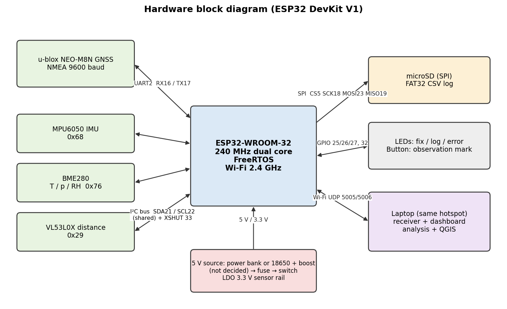
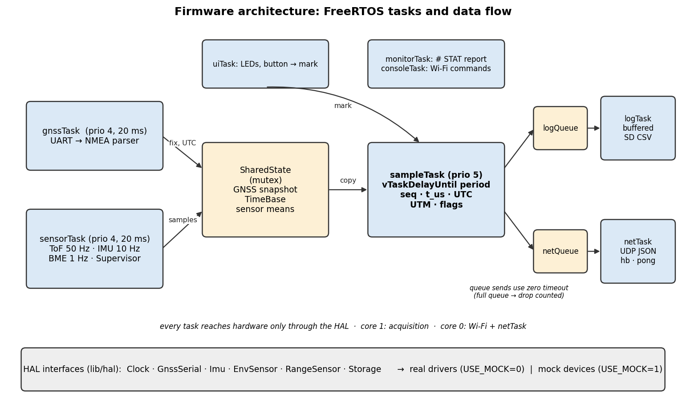
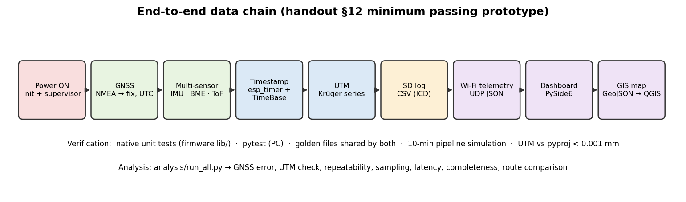

# D1 — Requirements & Architecture

ENG401 Interdisciplinary Engineering Design · Portable Smart Surveying & Environmental Mapping System

> Draft prepared by the software lead. Sections marked **[TEAM]** need input from the hardware and
> Geomatics members (names, final hardware decisions, survey area).

## 1. Problem statement

Surveying and environmental mapping usually rely on separate instruments and manual note-taking,
which makes it slow to know *where* each measurement was taken and hard to check data quality in the
field. We design a hand-carried device that, while walked along a route, measures position (GNSS),
motion (IMU), air temperature/pressure/humidity and distance to a target, stamps every measurement with
one common time reference, converts positions to UTM, stores the full dataset locally, streams it live
to a laptop, and turns it into a georeferenced GIS map — with quantitative evidence of how well each
part works.

## 2. Objectives

1. Acquire GNSS + IMU + environmental + distance data at a fixed, configurable rate (default 1 Hz).
2. Give every record a sequence number, a monotonic device timestamp and UTC derived from GNSS.
3. Convert WGS84 latitude/longitude to UTM on the device, verified against an independent implementation.
4. Never lose data silently: buffered SD logging, counted drops, sensor fault recovery.
5. Live monitoring on a laptop over Wi-Fi, with measured packet loss and sensor-to-PC latency.
6. Produce GIS layers (trajectory, observation points, thematic map) and a validation report for all
   required tests.

## 3. Requirements and how they are met

| ID | Requirement (handout) | Acceptance criterion (ours) | Design / implementation | Verification | Status |
|---|---|---|---|---|---|
| R1 | Multi-sensor acquisition | GNSS, IMU, BME280, VL53L0X in every record with a validity flag | `sensorTask`, `gnssTask`; HAL drivers `src/app/drivers/` | Diag firmware; `test_mocks`, `test_record_builder`; field T2 | Code + sim ✔, hardware pending |
| R2 | GNSS positioning | lat, lon, UTC, satellites, HDOP, altitude, speed, course | NMEA parser `lib/nmea` (GGA/RMC/VTG, any talker) | `test_nmea_parser`, PC `test_nmea` (same golden file) | ✔ |
| R3 | Lat/lon → UTM; zone, E, N | difference to pyproj < 1 mm | Krüger series 6th order `lib/geo/utm.cpp`, incl. Norway/Svalbard zones | `test_utm` (18 pyproj vectors, max 0.0006 mm), `analysis/verify_utm.py` | ✔ |
| R4 | Common time reference | all fields stamped at the same sampling instant; UTC from GNSS | `esp_timer` µs + `rt::TimeBase` (min-lag GNSS offset) | `test_rt`, `test_pipeline_sim` (bias = receiver latency, documented) | ✔ (no PPS: see §8) |
| R5 | Non-blocking firmware | no `delay()` in tasks; bounded I/O; sampling never blocks | FreeRTOS tasks, `vTaskDelayUntil`, queues with zero-timeout send, I²C timeout 20 ms, non-blocking ToF poll | `# STAT` interval statistics, stack high-water marks; field T3 | Code ✔, hardware pending |
| R6 | Local logging of the complete dataset | 100 % of records on SD; drops counted | `lib/logger` 4 KB buffer, 5 s flush, rotation, card-removed recovery | `test_logger` (9 cases), `test_pipeline_sim` (600/600); field T4 | Code + sim ✔ |
| R7 | Wireless telemetry | every record sent; loss measurable | UDP JSON (ICD §3), heartbeat, broadcast discovery | `test_telemetry`, PC `test_telemetry_e2e` (real UDP); field T5 | Code + localhost ✔ |
| R8 | Live monitoring | connection, position, UTM, sensors, GNSS quality on screen | PySide6/pyqtgraph dashboard | `test_dashboard_model`; demo screenshot `docs/img/dashboard_demo.png` | ✔ (virtual device) |
| R9 | GIS visualisation | trajectory + observation points + ≥ 1 thematic map | GeoJSON export `surveypc/analysis/gis.py`, QGIS guide | `test_analysis`; QGIS map by GE team | Tools ✔, map pending field data |
| R10 | Field survey on a predefined route | complete dataset on the planned route | Field procedure `docs/geomatics-team/`, test plan `docs/hardware-team/04` | D5 | Pending **[TEAM]** |
| R11 | Quantitative validation | all 7 tests of handout §9 computed | `analysis/run_all.py` | `test_analysis` on simulated data with known truth | Tools ✔, field data pending |

Required tests (handout §9) → analysis section and data source:

| Test | Metric | Computed by | Data |
|---|---|---|---|
| GNSS accuracy | mean, RMSE, std, max, CEP, satellites, HDOP | `tests.gnss_static`, `gnss_marks` | static test T6 + observation points |
| Coordinate transformation | device vs pyproj | `utm_check` | any survey file |
| Sensor repeatability | mean, std, range | `tests.sensor_repeatability` | static test |
| Sampling performance | requested vs actual interval, missed | `tests.sampling_performance` | 30-min bench test T3 |
| Communication latency | min / mean / max (± sync uncertainty) | `tests.latency` (NTP-style clock sync) | receiver log T5 |
| Data completeness | valid / expected × 100 (several levels) | `tests.completeness` | survey + receiver log |
| Field trajectory | cross-track distance to planned route | `tests.route_comparison` | survey + planned route (GE) |

## 4. System architecture

### 4.1 Hardware

Pin assignment: `docs/PINOUT.md`. Parts: `reference/ENG401_Satin_Alinacak_Malzemeler.docx`
(awaiting instructor approval). GNSS: u-blox NEO-M8N (team-owned).

### 4.2 Firmware

- **Hardware abstraction layer:** the application talks only to interfaces; a build flag selects real
  drivers or deterministic mock devices (noise, fix loss, sensor faults). This allowed the complete
  software to be developed and tested before hardware was available.
- **Tasks and priorities:** sampling (5) > GNSS, sensors (4) > logging, telemetry (2) > UI, monitor,
  console (1). Acquisition on core 1, Wi-Fi on core 0.
- **Timing:** `vTaskDelayUntil` keeps a fixed period without drift; late ticks re-synchronise and are
  counted as missed instead of firing in bursts.
- **Fault handling:** per-sensor supervisor (3 consecutive errors → re-init with 1–30 s back-off), SD
  error → keep buffering + retry with a new file, Wi-Fi loss → auto-reconnect, data stays on SD.
- **Field configuration:** Wi-Fi credentials set over the serial console and stored in NVS (no rebuild).

### 4.3 Data chain and PC software

- **Protocol:** UDP, one JSON object per datagram, `seq` + device timestamp in every record,
  heartbeat 1 Hz, ping/pong for clock offset (ICD §3). UDP keeps loss and latency visible; the SD card
  holds the complete dataset.
- **Data format:** one CSV row per sampling tick, 29 columns with units (ICD §2). Firmware and PC codecs
  are tested byte-for-byte against shared golden files.
- **PC:** receiver (loss accounting, latency), dashboard, virtual ESP32 (replays data as live telemetry),
  replay of raw logs, analysis and GIS export.

## 5. Software verification strategy

| Level | Tooling | Count (current) |
|---|---|---|
| Firmware pure logic | PlatformIO native + Unity (host) | 82 tests |
| PC software | pytest (incl. real UDP on localhost) | 59 tests |
| Cross-language format | shared golden CSV/JSON/NMEA files | both suites |
| Integration (simulated) | 10-min pipeline simulation, virtual ESP32 → receiver → dashboard | ✔ |
| Hardware bring-up | diagnostic firmware with copy-paste report | pending hardware |
| Field | test plan T1–T8 | pending |

## 6. Roles **[TEAM]**

| Member | Discipline | Responsibility |
|---|---|---|
| *(name)* | CE | Software lead (remote): firmware, PC software, protocol, analysis tools |
| *(names)* | CE | Hardware: power board, wiring, enclosure/pole, flashing, bench tests T1–T8 |
| *(names)* | GE | Survey design and route, reference points, GNSS accuracy analysis, independent UTM check, GIS maps |

## 7. Risks and mitigations

| Risk | Impact | Mitigation |
|---|---|---|
| Software lead has no hardware access | integration delays | HAL + mocks + simulation; diagnostic firmware; replay of logs sent by the team |
| Phone hotspot blocks client-to-client / broadcast traffic | no telemetry | test early (T1); SD log is complete regardless; try another hotspot |
| GNSS multipath on campus | larger errors | quantify with HDOP/satellites; static test in open area |
| Wrong sensor delivered (e.g. BMP280 instead of BME280) | missing humidity | diag firmware checks chip IDs |
| Power interruption | data loss | SD flush every 5 s (≤ 5 s loss), new file per boot |

## 8. Known limitations and open items

- No PPS line assumed: UTC is biased by the receiver's NMEA output latency (tens of ms, not observable
  without PPS); jitter is removed by the time base.
- Sensor-to-PC latency is measured with ± rtt/2 clock-sync uncertainty (reported with every result).
- Open hardware decisions **[TEAM]**: power option, VL53L0X vs VL53L1X, GNSS module supply voltage and
  connector pinout (see the unknowns table in `CLAUDE.md`).
